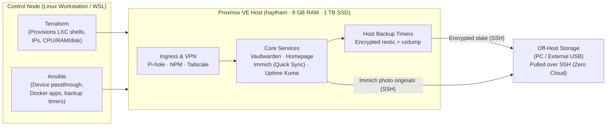

# Haytham Homelab

A self-hosted home server running on a single quiet, low-power **Lenovo ThinkCentre M910q Tiny** — providing private photo backup, password management, network-wide ad blocking, remote VPN access, and automated zero-cloud backups, all provisioned reproducibly from code.

## Why I Built This

I wanted full ownership of my everyday personal data (especially family photos and passwords) without paying recurring cloud subscriptions or maintaining a fragile, click-ops server. Every container, service, and backup schedule in this repository is defined as Infrastructure as Code (**Terraform + Ansible**) and backed by a structured knowledge base so the entire lab can be rebuilt cleanly from scratch.

## Hardware at a Glance

| Component | Spec |
|---|---|
| **Machine** | Lenovo ThinkCentre M910q Tiny |
| **CPU / GPU** | Intel Core i5 (7th Gen, 4c/4t) with Intel HD 630 Quick Sync (hardware video transcoding) |
| **Memory** | 8 GB RAM *(tuned lean; upgrade to 16 GB planned)* |
| **Storage** | 1 TB SSD |
| **Hypervisor** | Proxmox VE (single-node) |

## What's Running

All services run inside lightweight Linux containers (LXCs) — one service per container — behind clean internal HTTPS URLs (`*.haytham.internal`):

| Service | What It Does | Replaces |
|---|---|---|
| **Immich** | Private photo & video backup with Intel Quick Sync transcoding and mobile auto-sync | Google Photos / iCloud Photos |
| **Vaultwarden** | Self-hosted, Bitwarden-compatible password manager | Cloud password managers |
| **Pi-hole** | Network-wide ad blocking and internal DNS resolver (`*.haytham.internal`) | ISP DNS / per-device ad blockers |
| **Nginx Proxy Manager** | Reverse proxy providing HTTPS with a single wildcard TLS certificate | Remembering raw `IP:port` URLs |
| **Tailscale** | Private WireGuard VPN into the home network with zero open router ports | Port forwarding / exposed services |
| **Homepage** | Unified start-page dashboard (`https://haytham.internal`) | Scattered bookmarks |
| **Uptime Kuma** | Real-time service health checks and downtime monitoring | Finding out something broke too late |
| **Automated Backups** | Daily encrypted snapshots (`restic`), weekly container snapshots (`vzdump`), and off-host SSH sync | Third-party cloud backup services |

*Ready to enable after a 16 GB RAM upgrade (preserved in-repo): Home Assistant OS, shared PostgreSQL/Redis + pgAdmin, and Karakeep.*

## Architecture



## Key Design Principles

- **Reproducible by default:** Terraform handles the container lifecycle and stops once each container is reachable over SSH; idempotent Ansible roles take over from there.
- **Lean by design on 8 GB RAM:** Running Linux containers instead of heavy VMs keeps steady-state usage around ~3.1 GB RAM, leaving ~4.5 GB headroom for Immich uploads and ML jobs.
- **Zero-cloud, zero-port-forwarding security:** Remote access runs exclusively over Tailscale, backups are encrypted locally and pulled over SSH (no cloud uploads, no SMB/Samba shares), and all secrets stay out of Git (inline Ansible Vault encryption + gitignored local state).
- **Documented once, linked everywhere:** Operational runbooks, Architecture Decision Records (ADRs), and per-service specs live in [`kb/`](kb/index.md) so documentation stays in sync with the infrastructure.

## AI-Assisted Operations

This repository is structured for both humans and AI coding assistants:

- **[`AGENTS.md`](AGENTS.md)** provides a lightweight, always-on summary of host facts, safety guardrails (such as never printing secrets or destroying disks without confirmation), and a routing map so an AI assistant never has to bulk-read the entire knowledge base.
- **[`.agents/skills/`](.agents/skills/)** defines five on-demand operational skills (`homelab-rebuild`, `homelab-backup-restore`, `homelab-add-service`, `homelab-secret-rotation`, and `homelab-update-reboot`) that load step-by-step runbooks only when needed.
- **[`kb/`](kb/index.md)** is authored with YAML frontmatter and focused single-topic Markdown files so it can also be indexed directly for RAG / Q&A.

## Repository Layout

```text
haytham-homelab/
├── AGENTS.md                  # AI guardrails, canonical facts & KB routing map
├── .agents/skills/            # On-demand AI runbook skills (rebuild, backup, updates, etc.)
├── terraform/                 # Proxmox LXC provisioning (bpg/proxmox)
├── ansible/                   # Host device passthrough, app roles & backup timers
├── scripts/                   # Off-host SSH backup pull scripts (Linux/WSL + native Windows cmd)
└── kb/                        # Canonical Knowledge Base (architecture, ADRs, services, runbooks)
```

## Where to Dive Deeper

- **Architecture & Decisions:** [Overview](kb/architecture/overview.md) · [Lean 8 GB Scope (`ADR-007`)](kb/decisions/ADR-007-lean-8gb-phase1.md) · [IP & CTID Matrix](kb/reference/ip-ctid-matrix.md)
- **Operational Runbooks:** [Build from Scratch](kb/operations/build-from-scratch.md) · [Backup & Restore Drills](kb/operations/backup-and-restore.md) · [System Updates & Reboots](kb/operations/update-and-reboot.md) · [Secret Rotation](kb/operations/secret-rotation.md)
- **Full Documentation Index:** [Knowledge Base Index](kb/index.md)
